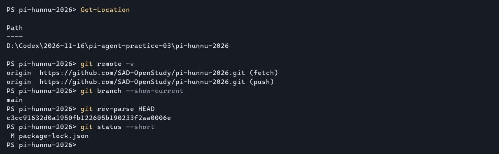
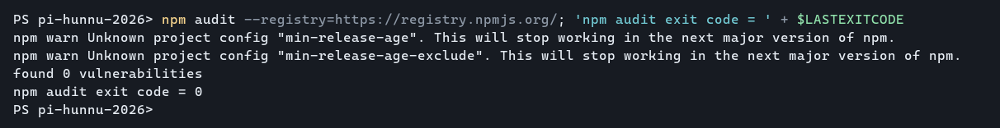
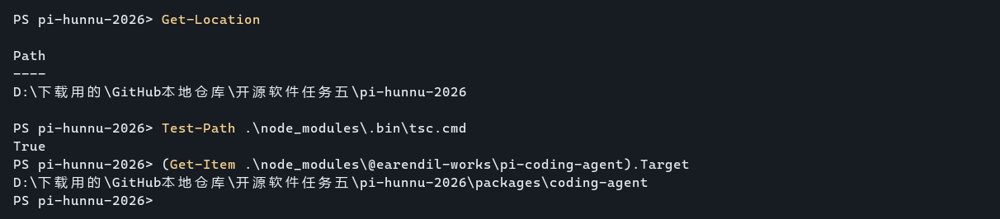
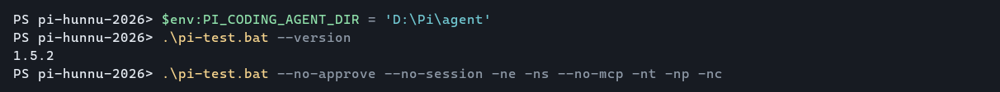
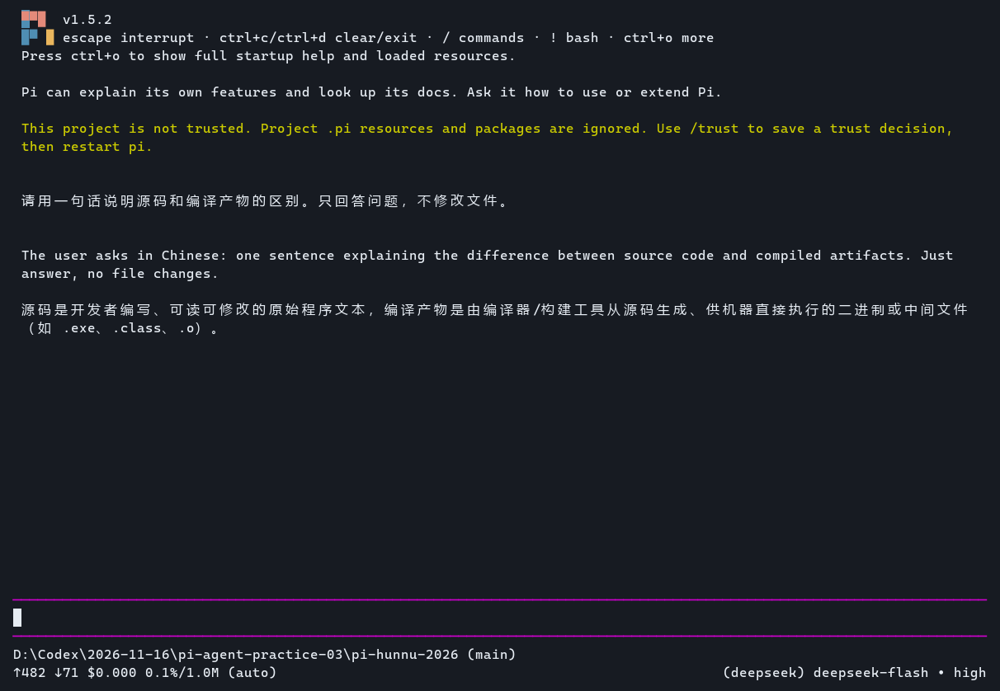
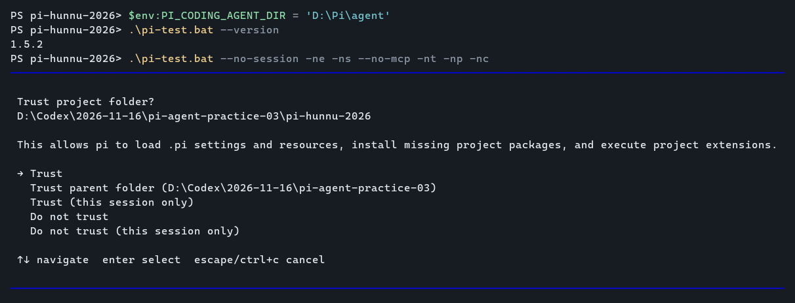

# 实践课 3：Pi Agent 源码安装与编译

实验人 **liaobohan**　｜　2026 年 11 月 16—17 日

## 一、实验环境

实验在 Windows 11（x64）的 PowerShell 中进行。Node.js 为 `v24.12.0`，npm 为 `11.6.2`，Git 为 `2.55.0.windows.5`。源码仓库要求 Node.js `>=22.19.0`，本机版本符合要求。


## 二、获取源码和查看配置

从小组仓库克隆 `main` 分支。复验目录为 `D:\下载用的\GitHub本地仓库\开源软件任务五\pi-hunnu-2026`，源码提交为 `c3cc91632d0a1950fb122605b190233f2aa0006e`。克隆完成后，`git status --short` 没有输出。[小组仓库](https://github.com/SAD-OpenStudy/pi-hunnu-2026)



源码仓库的 README 给出了构建命令。`package.json` 里的 `workspaces` 列出由根目录统一管理的子包，开发依赖中有 TypeScript 和 esbuild。`npm run build` 读取根目录的 `scripts.build`，再依次执行各子包的构建命令。命令用 `&&` 连接，前一步成功才会继续。


## 三、安装依赖

在仓库根目录执行 `npm install --ignore-scripts`。npm 根据根配置和锁文件，把依赖装入 `node_modules` 并连接本地工作区。`--ignore-scripts` 会跳过安装阶段的生命周期脚本。11 月 16 日首次安装新增了 335 个包，退出码为 `0`。


用 `npm audit --registry=https://registry.npmjs.org/` 补查，返回 `found 0 vulnerabilities`。



11 月 17 日在指定目录复验时，沿用同一源码提交已装好的依赖。`tsc.cmd` 在本地 `node_modules` 中，`pi-coding-agent` 的工作区链接也指向新目录里的源码。



## 四、编译和检查产物

首次执行 `npm run build` 成功。这个命令会在 `ai` 子包更新模型目录。复验时在线更新等待太久，改用上一次生成的模型目录数据，再执行 `npm run build:offline`。离线脚本会先校验模型目录，再编译各子包。

```powershell
npm run build:offline
$LASTEXITCODE
Test-Path .\packages\coding-agent\dist\bundle\cli.js
node .\packages\coding-agent\dist\bundle\cli.js --version
```

构建退出码为 `0`，入口文件检查返回 `True`，直接运行打包后的 CLI 得到版本 `1.5.2`。


## 五、运行源码版

运行 `.\pi-test.bat --version`，输出 `1.5.2`。这个批处理通过 `pi-test.ps1` 加载当前仓库的 `packages/coding-agent/src/cli.ts`，适合改动源码后直接调试。`dist/bundle/cli.js` 是打包后的入口，用于检查编译结果。



启动后用 `deepseek-flash` 测试了一次问答，询问源代码和编译产物的区别。模型回答说，源码是人可以阅读和编辑的程序文本，编译产物是编译器生成的可执行文件或中间文件。



## 六、遇到的问题

1. npm 11.6.2 提示不识别 `.npmrc` 中的 `min-release-age` 和 `min-release-age-exclude`。安装日志中还有 `deprecated` 提示，最后以退出码判断命令是否成功。
2. 在中文路径下，TypeScript 编译通过，复制资源时返回 Windows 错误码 `3221226505`。复制步骤改用指向同一源码目录的临时英文联接后，离线构建通过。联接指向的目录见 S5。
3. 用 `Test-Path` 确认已有 Pi 配置在 `D:\Pi\agent`，将本次会话的 `PI_CODING_AGENT_DIR` 指向该目录。源码版启动时出现 `Trust project folder?`，加上 `--no-approve` 后继续完成了问答。



