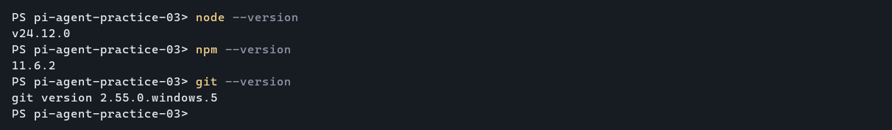
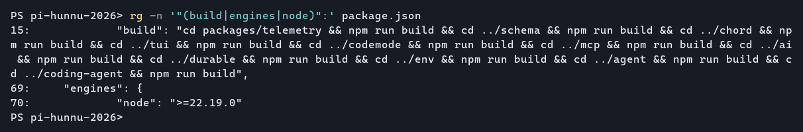
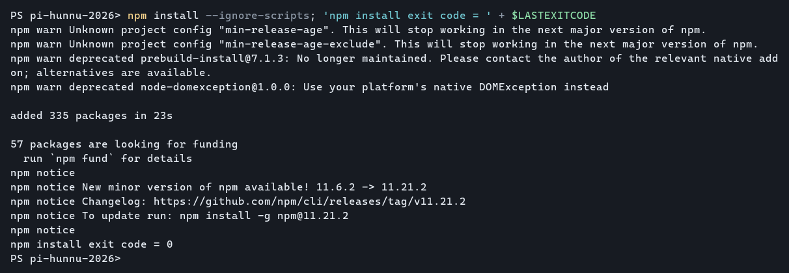
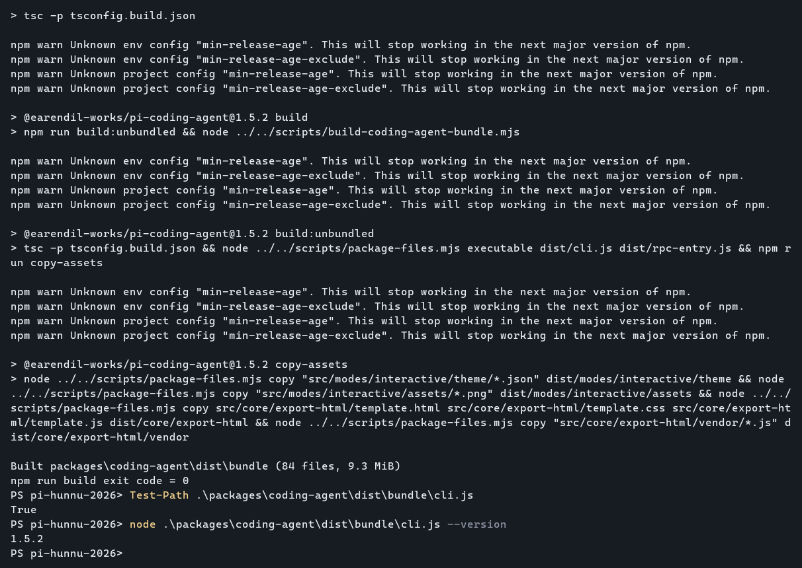
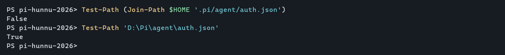

# 实践课3：Pi Agent 源码安装与编译

实验人 **liaobohan**　｜　实验日期 **2026 年 11 月 16 日**

实验截图来自本机 Windows 伪终端实际运行的 PowerShell 和 Pi 会话。[课程实践三说明](https://github.com/hunnuOpenSourceSoftware2026/assignments/blob/main/practice/03-Pi-Agent-source-build.md)

## 一、检查开发环境

| 工具 | 实测版本 | 用途 |
| --- | --- | --- |
| Windows 11 x64 | 25H2 | 本地实验系统 |
| PowerShell | 7.6.9 | 执行仓库获取、安装和构建命令 |
| Node.js | v24.12.0 | 运行构建脚本和 Pi CLI |
| npm | 11.6.2 | 管理工作区依赖和调度构建脚本 |
| Git for Windows | 2.55.0.windows.5 | 下载小组源码并核对来源与提交 |

根项目在 `engines.node` 中声明 `>=22.19.0`。本机的 Node.js 24 满足要求，直接使用现有版本。



## 二、获取并核对小组仓库

```powershell
git clone --branch main --single-branch --depth 1 https://github.com/SAD-OpenStudy/pi-hunnu-2026.git
cd pi-hunnu-2026
Get-Location
git remote -v
git branch --show-current
git rev-parse HEAD
git status --short
```

实验使用实践二的小组 fork。`origin` 的拉取和推送地址一致，当前分支为 `main`，完整提交号为 `c3cc91632d0a1950fb122605b190233f2aa0006e`。实际仓库根目录为 `D:\Codex\2026-11-16\pi-agent-practice-03\pi-hunnu-2026`。[小组仓库](https://github.com/SAD-OpenStudy/pi-hunnu-2026)

克隆后工作树干净。抓取 S2 时依赖安装已经结束，`git status --short` 显示的 `M package-lock.json` 来自 npm 写回锁文件。第七节记录了差异核对结果。


## 三、阅读配置与构建脚本

| 文件 | 本次核对结果 |
| --- | --- |
| [根目录 README 的 Development](https://github.com/SAD-OpenStudy/pi-hunnu-2026/blob/c3cc91632d0a1950fb122605b190233f2aa0006e/README.md#development) | 提供依赖安装、在线构建、离线重建和开发检查命令。 |
| [根目录 package.json](https://github.com/SAD-OpenStudy/pi-hunnu-2026/blob/c3cc91632d0a1950fb122605b190233f2aa0006e/package.json) | `engines.node` 声明 Node.js 的最低版本。`workspaces` 覆盖 `packages/*`、`apps/*` 及指定示例。`devDependencies` 包含 TypeScript 和 esbuild 等构建工具。 |
| [根目录 package-lock.json](https://github.com/SAD-OpenStudy/pi-hunnu-2026/blob/c3cc91632d0a1950fb122605b190233f2aa0006e/package-lock.json) | 锁文件版本为 `3`，记录解析出的包版本、依赖链接和完整性信息。 |
| [packages/](https://github.com/SAD-OpenStudy/pi-hunnu-2026/tree/c3cc91632d0a1950fb122605b190233f2aa0006e/packages) | 包含多个可单独构建的工作区子包。 |
| [packages/coding-agent/package.json](https://github.com/SAD-OpenStudy/pi-hunnu-2026/blob/c3cc91632d0a1950fb122605b190233f2aa0006e/packages/coding-agent/package.json) | `build` 先编译 TypeScript、复制资源，再执行打包脚本。`bin.pi` 指向 `dist/bundle/cli.js`。 |

从根目录执行 `npm run build` 时，npm 首先读取根 `package.json` 的 `scripts.build`。该脚本按下列顺序进入子包，再读取各子包 `package.json` 中的 `scripts.build`。`&&` 让前一条命令成功后才执行下一条。

`telemetry → schema → chord → tui → codemode → mcp → ai → durable → env → agent → coding-agent`



## 四、在根目录安装依赖

```powershell
npm install --ignore-scripts
$LASTEXITCODE
```

npm 依据根 `package.json` 的依赖声明及根锁文件，解析并安装依赖到项目的 `node_modules`，同时为本地工作区建立链接。实际检查发现 `node_modules/@earendil-works/pi-coding-agent` 是指向 `packages/coding-agent` 的目录联接。`--ignore-scripts` 跳过安装阶段的 `prepare`、`postinstall` 等生命周期脚本。随后手动执行的 `npm run build` 仍会运行项目定义的构建脚本。

安装输出为 `added 335 packages in 23s`，退出码 `0`。日志中的 `Unknown project config` 和 `deprecated` 属于警告，处理过程见第七节。



安装输出未给出漏洞审计汇总，因此对当前依赖树使用官方 npm 注册表补查。`npm audit --registry=https://registry.npmjs.org/` 返回 `found 0 vulnerabilities`，退出码 `0`。该结果对应本次查询时审计库中已知的漏洞。


## 五、本地编译并验证产物

```powershell
npm run build
$LASTEXITCODE
Test-Path .\packages\coding-agent\dist\bundle\cli.js
node .\packages\coding-agent\dist\bundle\cli.js --version
```

首次构建在 `ai` 子包执行 `generate-models`，向 models.dev、OpenRouter 和 Vercel AI Gateway 获取目录数据，生成各提供商目录及 `src/models.generated.ts`。目录数据描述模型标识、接口和能力，推理调用由配置的模型服务处理。生成数据通过校验后，根脚本继续构建其余工作区。已有有效模型目录数据时，项目提供 `npm run build:offline` 用于复用数据并重新编译。依据见 [AI 子包构建配置](https://github.com/SAD-OpenStudy/pi-hunnu-2026/blob/c3cc91632d0a1950fb122605b190233f2aa0006e/packages/ai/package.json)。

| 验证项 | 实测结果 |
| --- | --- |
| 根构建退出码 | `0` |
| CLI 打包汇总 | `84 files, 9.3 MiB` |
| 本地 `dist/bundle/cli.js` 存在 | `True` |
| 通过该路径运行 `--version` | `1.5.2` |



## 六、启动源码版并完成会话

```powershell
$env:PI_CODING_AGENT_DIR = 'D:\Pi\agent'
.\pi-test.bat --version
.\pi-test.bat --no-approve --no-session -ne -ns --no-mcp -nt -np -nc
```

`.\pi-test.bat --version` 输出 `1.5.2`。批处理入口调用同目录的 `pi-test.ps1`，该脚本为 Node.js 加载源码解析器，再执行本仓库的 `packages/coding-agent/src/cli.ts`。这条实际加载路径确认运行的是小组仓库里的源码。源码入口适合在开发时直接验证 `src` 中的改动，`dist/bundle/cli.js` 适合检验编译、打包结果和 CLI 发布入口。[pi-test.bat](https://github.com/SAD-OpenStudy/pi-hunnu-2026/blob/c3cc91632d0a1950fb122605b190233f2aa0006e/pi-test.bat) [pi-test.ps1](https://github.com/SAD-OpenStudy/pi-hunnu-2026/blob/c3cc91632d0a1950fb122605b190233f2aa0006e/pi-test.ps1)

本次只做一轮概念问答。`--no-session` 使用临时会话，`-nt` 关闭工具，其余参数关闭扩展、技能、MCP、提示模板和上下文文件的发现或加载，并为本次运行指定项目的信任状态。


交互界面显示 Pi `1.5.2`，使用 `deepseek-flash` 完成一轮问答。回复显示后按 Ctrl+D 回到 PowerShell。

**提示词**

> 请用一句话说明源码和编译产物的区别。只回答问题，不修改文件。

**模型实际回复**

> 源码是开发者编写、可读可修改的原始程序文本，编译产物是由编译器/构建工具从源码生成、供机器直接执行的二进制或中间文件（如 .exe、.class、.o）。

在本实验中，产物包括打包生成的 JavaScript，`cli.js` 入口由 Node.js 运行。


## 七、遇到的问题与处理

### 1. npm 识别不了两项项目配置

安装和编译中出现 `Unknown project config "min-release-age"`、`"min-release-age-exclude"`。把警告名称与项目的 `.npmrc` 比对，确认这两项均出自仓库配置，本机 npm 11.6.2 提示不识别。`prebuild-install` 和 `node-domexception` 的 `deprecated` 消息表示维护状态。根据 S4、S5 的退出码和 CLI 验证结果，使用当前版本完成了实验。已知漏洞情况以 S4 补图所示的官方注册表审计为准。[根目录 .npmrc](https://github.com/SAD-OpenStudy/pi-hunnu-2026/blob/c3cc91632d0a1950fb122605b190233f2aa0006e/.npmrc)

安装后用 `git diff -- package-lock.json` 查看差异，并比较前后包路径和版本。npm 调整了部分条目的 `libc` 与 `peer` 元数据，包路径集合和版本号一致。锁文件变化留在本地源码实验目录。

### 2. 源码版要定位已有的模型登录配置

课件中的默认配置目录为 `~/.pi/agent`。实测默认位置没有 `auth.json`，已有的 Pi 配置在 `D:\Pi\agent`。用 `Test-Path` 核对两个位置后，给当前 PowerShell 会话设定 `PI_CODING_AGENT_DIR`，使源码版直接读取现有配置。截图只记录了文件是否存在。



### 3. 首次启动停在项目目录信任提示

从刚克隆的仓库启动时，Pi 显示 `Trust project folder?` 并等待选择。为了完成一次简单问答，本次通过 `--no-approve` 以未信任项目模式继续启动，普通问答可使用已配置的模型。该参数作用于本次进程。最终交互结果见 S6。


